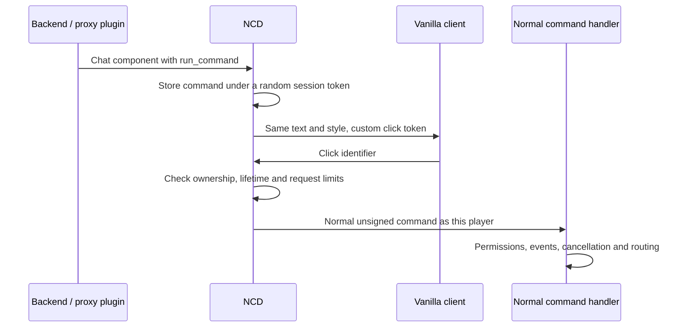

<div align="center">

# NCD · No Confirmation Dialogs

**Your chat buttons. One click.**

Native command clicks for **Paper · Leaf · Velocity · BungeeCord**

[](https://github.com/tommasobenatti/NoConfirmationDialogs/releases/latest)
[](https://github.com/tommasobenatti/NoConfirmationDialogs/releases)
[](https://github.com/tommasobenatti/NoConfirmationDialogs/actions/workflows/build.yml)
[](#compatibility)
[](LICENSE)


**[Download](https://github.com/tommasobenatti/NoConfirmationDialogs/releases/latest) · [Installation](#installation) · [How it works](#how-it-works) · [Servers & sponsors](docs/SERVERS.md) · [Report an issue](https://github.com/tommasobenatti/NoConfirmationDialogs/issues)**

Created and maintained by **[Tommaso Benatti — tommasobenatti](https://github.com/tommasobenatti)**.

</div>

NCD removes Minecraft's extra **Confirm Command Execution** screen from clickable **chat commands**. Drop the JAR into `plugins/`, restart, and existing teleport buttons, chat menus and command links work immediately.

**One JAR. No configuration. No client mod. No ProtocolLib or PacketEvents. No database or Redis.** Other plugins keep their existing messages and configuration. Player permissions and command cancellation remain enforced.

## Installation

1. Download `NoConfirmationDialogs-1.0-stable.jar` from the [latest release](https://github.com/tommasobenatti/NoConfirmationDialogs/releases/latest).
2. Stop the relevant server/proxy, put the JAR in its `plugins/` folder, and start it again.
3. Reconnect and click an existing chat command, such as a HuskHomes teleport request.

Choose the deployment that matches where your messages originate:

| Deployment | What it covers | What remains outside that installation |
| --- | --- | --- |
| **Paper/Leaf only, standalone server** | Plugin messages, `/tellraw`, system chat, disguised chat, unsigned decorations on player chat, and bundled chat components generated by that server. Commands execute through its normal player command handler. | A separate proxy's own messages and commands. |
| **Proxy only** | Chat created by Velocity/BungeeCord plugins, plus backend **system-chat** packets passing through the proxy. Proxy commands run locally; other commands follow normal forwarding to the current backend. | Click actions embedded in raw player-chat decorations or disguised chat that the proxy does not decode. |
| **Proxy + every Paper/Leaf backend** | Both sets above, including the backend chat types the proxy cannot decode. Backend token registrations reach the proxy independently of the chat packet type, so those clicks also pass through proxy command events and routing. | Books, modal dialog definitions, unrelated confirmation menus and unsupported protocols. |

**For a network, use the same current JAR on the proxy and every backend.** Each layer starts automatically; there is no channel setup or shared secret to configure. This is the recommended deployment for complete chat coverage and proxy command-policy enforcement. Update all layers together; mixed candidate/stable versions are not supported.

Paper-only installation behind an existing proxy fixes backend chat locally, but cannot intercept messages authored by the proxy or preserve its command-event layer. A backend button intended to run a proxy command needs NCD on the proxy too. On an actual standalone Paper/Leaf server, no proxy installation is needed.

Multiple proxies keep independent, connection-local registries. No external state is shared. A proxy failover/reconnect starts a fresh registry; old chat buttons may need to be sent again.

## How it works

Minecraft shows its confirmation when a `run_command` click cannot be parsed by the client or requires elevated permission. NCD uses Minecraft's native `custom` click action instead:



With both layers installed, Paper also sends a small **native server-to-proxy registration message before the chat packet**. The proxy learns every backend token even if its chat packet stays opaque. Incoming client messages cannot create these registrations, and incoming payload text never selects the command to execute. This is plugin messaging on the existing Minecraft connection, with no database, extra port or external service.

Tokens bind to the recipient connection, not to a visible mouse gesture: modified clients can replay their own valid tokens, just as they can type an allowed command. NCD still applies command permission checks and rate limits. Proxy-side buttons follow normal routing to the current backend after a switch; they are not a cross-server authorization grant.

## Compatibility

| Platform / requirement | Support |
| --- | --- |
| Minecraft releases | **1.21.6, 1.21.7, 1.21.8, 1.21.9, 1.21.10, 1.21.11, 26.1.1, 26.1.2, 26.2, 26.3** |
| Paper | Native runtime probes across every release above |
| Leaf | Paper adapter; Leaf 26.3 tested |
| Velocity | Versions that support the client's protocol; 3.4.0, 3.5.1, 4.0.0 and 4.3.1 distribution probes |
| BungeeCord | A current build supporting the client's protocol |
| Java | Java 21 bytecode; use the Java version required by your host, including Java 25 for Minecraft 26.x |

Spigot/Bukkit without Paper, Folia, snapshots, future protocols and mixed-version layers are outside the supported matrix. Clients older than 1.21.6 do not need this feature; proxy handlers skip them, and Paper skips them when a locally installed ViaVersion reports their protocol. Protocol translation installed only on another machine is not part of the verified matrix.

## What changes — and what does not

- Existing `run_command` chat actions are converted automatically, including nested text, Adventure/Bungee components and namespaced commands such as `/huskhomes:tpaccept Alice`.
- Text, colors, hover content, URL prompts, `suggest_command`, clipboard actions and unrelated custom clicks keep their original purpose.
- Commands execute as the player. Permissions, command-event cancellation and unsigned/signed-argument restrictions remain in force. NCD does not run commands as console or turn rejected commands into permitted ones.
- Written-book item data, arbitrary modal dialog definitions and other plugins' purpose-built confirmation menus are not rewritten.

## Security and resource limits

The pre-release audit found and corrected proxy command-policy and consumed-request budget gaps. Regression tests cover forged tokens, foreign sessions, manipulated payloads, malformed framing, non-system backend clicks, phase transitions and buffer ownership. See the [audit and performance report](docs/AUDIT.md), [verification](docs/VERIFICATION.md) and [security policy](SECURITY.md).

Each connection retains at most **4,096 entries and 262,144 command characters**, whichever is reached first. Text storage is bounded to at most 512 KiB of UTF-16 character data, excluding map/token overhead. Entries expire after 12 hours and are removed lazily; disconnect or disable clears the registry. Expired/evicted buttons need a fresh message.

NCD allows at most **20 resolved clicks per second**, with a separate **100 consumed requests / 1 MiB request-data budget per second** covering unknown and expired tokens too. Excess requests close that connection. It reuses host event loops, creates no production thread pool, and removes handlers during shutdown. Host packet decoders and network protection remain necessary.

These are fixed one-second windows; Paper charges a conservative decoded-NBT size when its wire buffer is gone. Components beyond 64 nesting levels, 8,192 JSON nodes or 262,144 aggregate string characters keep their original form, so those exceptional buttons may still show Minecraft's confirmation.

Consumed requests also count toward the host's native packet limits. Paper-specific custom-click `DROP`/`KICK` rules remain effective; a converted command is globally counted once. Bungee's native packet/byte counter is charged even for unknown NCD tokens.

NCD makes no “unexploitable” guarantee. Servers and plugins able to author command components are trusted message sources, and this plugin intentionally removes an extra client confirmation for their chat actions. Keep your host and permission setup updated.

## Build and contribute

```sh
mvn clean verify
```

Output: `target/NoConfirmationDialogs-1.0-stable.jar`. Host APIs are provided dependencies; no packet library is shaded or downloaded at runtime. Reproducible QA commands live in [qa/README.md](qa/README.md). CI builds and tests; release publication is a maintainer action.

Bug reports should include the Minecraft version, host build, where NCD is installed, and a minimal reproduction. Send security-sensitive reports through [GitHub's private security reporting](https://github.com/tommasobenatti/NoConfirmationDialogs/security), when enabled.

## Community and credits

**[MCExp — mcexp.it](https://mcexp.it)** is the first featured server using NCD. Visit [Servers & sponsors](docs/SERVERS.md) to learn about the showcase and request a listing.

The native custom-click idea was inspired by [DrexHD/remove-dialog-warning](https://github.com/DrexHD/remove-dialog-warning). NCD is an independently written implementation for Paper and proxy plugin ecosystems. Documentation structure was informed by [LuckPerms](https://github.com/LuckPerms/LuckPerms), [EssentialsX](https://github.com/EssentialsX/Essentials), [Paper](https://github.com/PaperMC/Paper), and [ViaVersion](https://github.com/ViaVersion/ViaVersion); their code, branding and endorsements are not claimed.

The download badge uses public GitHub release-asset downloads. The README image-view badge counts third-party image requests, **not unique visitors or GitHub's private repository traffic**. These badges run on the repository page; the plugin contains no telemetry.

Licensed under [MIT](LICENSE). © 2026 Tommaso Benatti / tommasobenatti.
